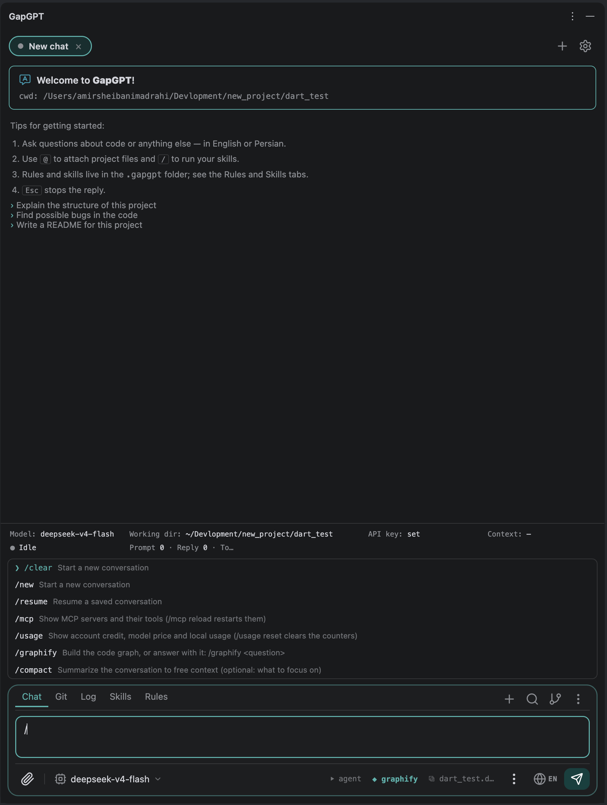
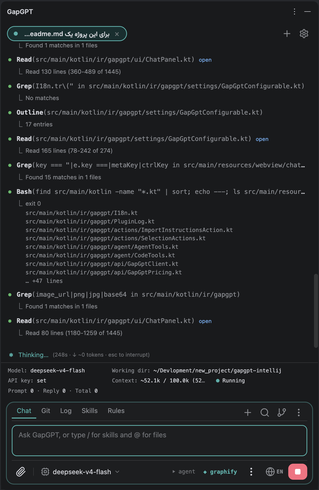

# GapGPT for JetBrains IDEs

**An AI coding agent and chat panel for IntelliJ IDEA, Android Studio, PyCharm, WebStorm and other JetBrains IDEs, with correct Persian / right-to-left (RTL) text.**

It connects to [GapGPT](https://gapgpt.app) (`api.gapgpt.app`), an OpenAI-compatible gateway to GPT, Claude, Gemini, DeepSeek, Grok, Qwen and other models.

[فارسی](README.md) · [Download the latest release](https://github.com/amirsheibani/gapgpt-intellij/releases/latest)





## Why

JetBrains terminals and most AI plugins break Persian text: letters are shown separated and in reverse order, and mixed Persian/English lines are scrambled. This plugin renders the chat in an embedded browser (JCEF) with proper bidi support, so Persian, English and code all display correctly.

## Features

**Chat**
- Direct connection to GapGPT's OpenAI-compatible API (`/v1/chat/completions`) with live streaming
- Live model list from GapGPT (`GET /v1/models`) with a searchable model menu
- Cost and credit tracking: estimated USD cost per reply; `/usage` shows account credit, current model price and per-model usage
- Multiple chats, auto-save, and `/resume`
- RTL panel with the Vazirmatn font; each paragraph detects its own direction, code and paths always stay LTR
- Copy and Insert-into-editor buttons on every code block; the current file/selection is sent as context

**Coding agent**
- Read, search, edit files and run commands, with your approval and a diff in the IDE's own Diff Viewer
- Code navigation through the IDE index (`find_symbol`, `file_outline`, `find_references`, `go_to_definition`, `file_relations`), no external tools needed
- Plan mode, task list, automatic context compaction, and MCP servers
- Optional code graph with `/graphify`

**Project rules and security**
- Project rules and skills from `.gapgpt/` (rules go into the system prompt, skills run as `/name`)
- One-click import of rules from other tools into `.gapgpt/`, without touching the originals
- Does not read or modify files of Claude Code, Cursor, Copilot and others (`AGENTS.md`, `CLAUDE.md`, `.claude/`, `.mcp.json`, `.git/hooks`)
- The API key is stored in the IDE's Password Safe, never in settings files or logs

## How it works

```
chat.js  ──send {chat,text}──►  ChatPanel.sendMessage
                                   │ skill expand / @file refs / IDE context
                                   │ Conversation.snapshot(systemPrompt)
                                   ▼
                              GapGptClient.send()   (pooled thread)
                                   │ POST {baseUrl}/chat/completions
                                   │ Authorization: Bearer <PasswordSafe>
                                   ▼
                       SSE (data: …) or JSON reply
                                   │
chat.js  ◄── delta / done / error / busy ──┘
```

1. **Request:** the system prompt is built from project rules, the IDE context (current file/selection) and `@file` references.
2. **API call:** `GapGptClient` sends the request on a background thread; the key is read only from Password Safe.
3. **Streaming:** the reply arrives as Server-Sent Events and is rendered as Markdown with RTL support.
4. **Tools:** when the model calls a tool, the agent runs it and sends the result back. Read-only tools run automatically; file edits and commands need your approval.
5. **Usage:** tokens and estimated cost are shown under each reply.
6. **Memory:** each chat is saved and automatically summarized when the context budget fills up.

## Install

1. Get an API key from [gapgpt.app](https://gapgpt.app/platform-v2/tokens).
2. Download `gapgpt-intellij-<version>.zip` from [Releases](https://github.com/amirsheibani/gapgpt-intellij/releases/latest).
3. In the IDE: **Settings › Plugins › ⚙ › Install Plugin from Disk…** and choose the zip.
4. Open **Settings › Tools › GapGPT** and paste your key.

Requires a JetBrains IDE 2024.2 or newer.

## Build from source

```bash
./gradlew buildPlugin   # needs JDK 21; output: build/distributions/
./gradlew runIde        # run a sandbox IDE with the plugin
```

## Tech stack

Kotlin · IntelliJ Platform SDK · JCEF (embedded Chromium) · Server-Sent Events · MCP · Gradle

## Project structure

```
src/main/kotlin/ir/gapgpt/
  api/        GapGptClient (HTTP, SSE streaming, models, credit), pricing, usage
  agent/      agent tools and IDE-index code navigation
  chat/       conversations, prompts, persistence
  context/    .gapgpt rules/skills and importer
  mcp/        MCP client and server management
  ide/        editor selection, file search, git, graphify
  ui/         ChatPanel: JCEF browser + JS ↔ Kotlin bridge
  settings/   settings UI + Password Safe key storage
  actions/    menu actions
src/main/resources/webview/   chat UI (Markdown, RTL, streaming)
```

## License

MIT. See [LICENSE](LICENSE).
