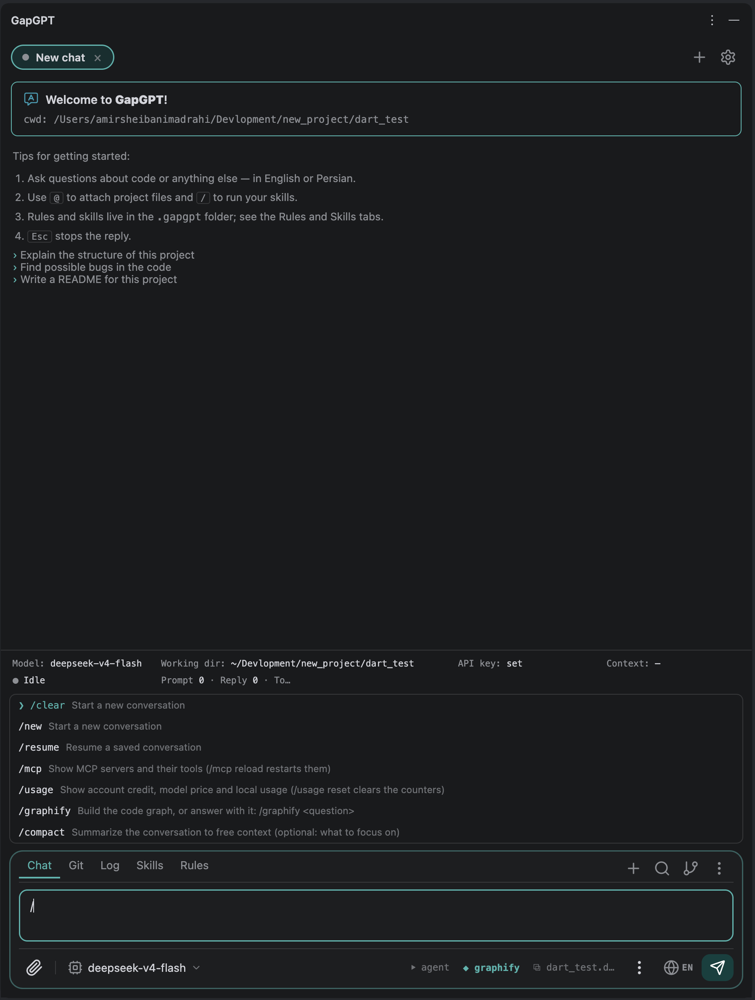
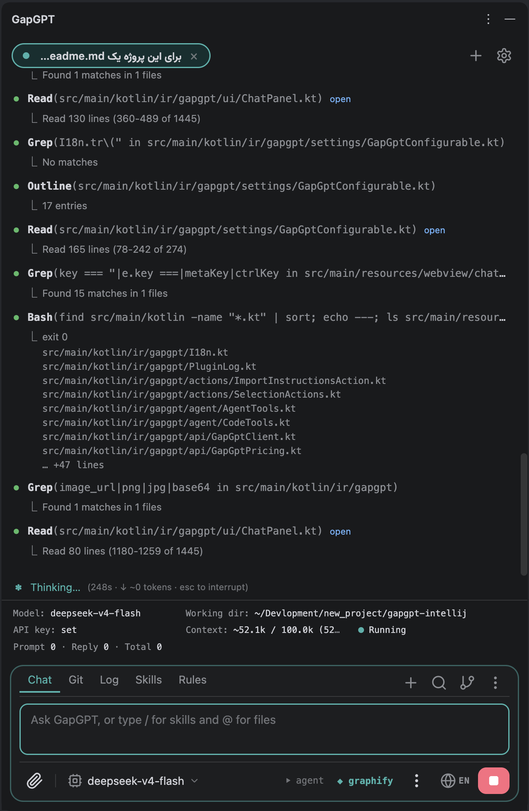

# GapGPT — دستیار و ایجنت هوش مصنوعی گپ‌جی‌پی‌تی داخل IDEهای JetBrains

یک پنل گفتگو و ایجنت برنامه‌نویسی که با مدل‌های **گپ‌جی‌پی‌تی** (`api.gapgpt.app`) کار می‌کند: GPT، Claude، Gemini، DeepSeek، Grok، Qwen و بقیه. داخل IntelliJ IDEA، PyCharm، WebStorm، Android Studio و بقیهٔ IDEهای JetBrains اجرا می‌شود و متن فارسی، راست‌به‌چپ و متن‌های ترکیبی فارسی/انگلیسی را درست نشان می‌دهد.





**اولین بار است؟** از [راهنمای شروع](docs/getting-started.md) شروع کنید. گرفتن کلید API، نصب، تنظیم و اولین گفتگو را قدم‌به‌قدم توضیح می‌دهد.

## امکانات

**گفتگو**
- اتصال مستقیم به API سازگار با OpenAI گپ‌جی‌پی‌تی (`/v1/chat/completions`) با نمایش زندهٔ پاسخ (streaming)
- **فهرست مدل‌ها از خود گپ‌جی‌پی‌تی:** دکمهٔ «دریافت مدل‌ها» در Settings و منوی مدل با جستجو در پنل چت (`GET /v1/models`)
- **هزینه و اعتبار:** خط مصرف هر پاسخ، علاوه بر توکن‌ها، هزینهٔ تخمینی را به دلار نشان می‌دهد. `/usage` اعتبار حساب، قیمت مدل فعلی و مصرف هر مدل را نشان می‌دهد.
- چند گفتگوی هم‌زمان، ذخیرهٔ خودکار و ادامهٔ گفتگو با `/resume`
- پنل راست‌به‌چپ با فونت **وزیرمتن**. هر پاراگراف جهت خودش را تشخیص می‌دهد و کد و مسیرها همیشه LTR می‌مانند.
- دکمه‌های **کپی** و **درج در ویرایشگر** برای هر بلوک کد، و ارسال خودکار فایل/انتخاب فعلی ویرایشگر

**ایجنت برنامه‌نویسی**
- خواندن، جستجو، ویرایش فایل و اجرای دستور، با تأیید شما و diff در Diff Viewer خود IDE
- **پیمایش کد با index خود IDE:** `find_symbol`، `file_outline`، `find_references`، `go_to_definition` و `file_relations`، بدون ابزار خارجی
- حالت طرح (plan mode)، فهرست کارها، خلاصه‌سازی خودکار context، و سرورهای MCP
- **graphify اختیاری:** `/graphify` گراف کد را در پوشهٔ خود IDE می‌سازد و `/graphify <سؤال>` با آن پاسخ می‌دهد

**پروژه و امنیت**
- **قوانین و اسکیل‌های پروژه** از `.gapgpt/`: قوانین به system prompt اضافه می‌شوند و اسکیل‌ها با `/نام` اجرا می‌شوند
- دکمهٔ **«کپی قوانین و اسکیل‌ها»** قوانین ابزارهای دیگر را در `.gapgpt/` کپی می‌کند و فایل‌های اصلی دست نمی‌خورند
- **بدون تداخل با ابزارهای دیگر:** فایل‌های Claude Code، Cursor، Copilot و بقیه (`AGENTS.md`، `CLAUDE.md`، `.claude/`، `.mcp.json`، `graphify-out/`، `.git/hooks`) را نمی‌خواند و تغییر نمی‌دهد
- کلید API در Password Safe خود IDE ذخیره می‌شود، نه در فایل تنظیمات یا لاگ

## چطور کار می‌کند

وقتی پیامی می‌فرستید، این جریان اتفاق می‌افتد:

<div dir="ltr">

```
chat.js  ──send {chat,text}──►  ChatPanel.sendMessage
                                   │ skill expand / @file refs / IDE context / ي→ی
                                   │ Conversation.snapshot(systemPrompt)
                                   ▼
                              GapGptClient.send()   (pooled thread)
                                   │ POST {baseUrl}/chat/completions
                                   │ Authorization: Bearer <PasswordSafe>
                                   ▼
                       SSE (data: …) or JSON reply
                                   │
chat.js  ◄── delta / done / error / busy ──┘
```

</div>

1. **ساخت درخواست:** پنل چت، system prompt را از قوانین پروژه (`.gapgpt/AGENTS.md` و `rules/`)، state راهنماها و دستورالعمل‌های IDE می‌سازد؛ اسکیل‌های `/نام` باز می‌شوند؛ ارجاع‌های `@فایل` به محتوای فایل تبدیل می‌شوند و زمینهٔ فعلی ویرایشگر (فایل/انتخاب) ضمیمه می‌شود.
2. **ارسال به API:** `GapGptClient.send()` درخواست `POST {baseUrl}/chat/completions` را با هدر `Authorization: Bearer <key>` می‌فرستد. کلید فقط از `ApiKeyStore`، یعنی PasswordSafe خود IDE، خوانده می‌شود و هیچ‌وقت لاگ نمی‌شود.
3. **پاسخ زنده:** پاسخ به‌صورت SSE (`text/event-stream`) قطعه‌قطعه می‌آید و در webview با markdown و RTL نمایش داده می‌شود. دکمهٔ توقف درخواست در جریان را لغو می‌کند.
4. **اجرای ابزارها:** اگر مدل ابزاری بخواهد (مثلاً خواندن یک فایل یا جستجو در کد)، ایجنت آن را اجرا و نتیجه را دوباره به مدل می‌دهد؛ تا «حداکثر گام در هر پیام» ادامه می‌یابد. ابزارهای فقط‌خواندنی بدون پرسش اجرا می‌شوند؛ **ویرایش فایل و اجرای دستور فقط با تأیید شما** و نمایش diff انجام می‌شود.
5. **مصرف و هزینه:** بعد از هر پاسخ، تعداد توکن‌ها و هزینهٔ تخمینی (دلار) زیر پاسخ می‌آید و مصرف هر مدل روی همین دستگاه ذخیره می‌شود؛ `/usage` هم اعتبار حساب و هم جدول مصرف را نشان می‌دهد.
6. **حافظه:** تاریخچهٔ هر گفتگو (تا ۲۰۰ پیام/۶۰۰ هزار نویسه) ذخیره می‌شود و در صورت پر شدن، خودکار خلاصه‌سازی می‌شود تا context از بودجه بیرون نزند. با `/resume` گفتگوی قبلی را ادامه می‌دهید.

جزئیات فنی API در [docs/gapgpt-api.md](docs/gapgpt-api.md) و جزئیات ابزارهای ایجنت در [docs/chat-agent.md](docs/chat-agent.md).

## پیش‌نیاز
1. یک **کلید API** از [gapgpt.app/platform-v2/tokens](https://gapgpt.app/platform-v2/tokens) و مقداری اعتبار در حساب. جزئیات در [راهنمای شروع](docs/getting-started.md).
2. IDE نسخهٔ 2024.2 یا جدیدتر
3. JDK 21، فقط برای build از سورس

## ساخت و نصب
```bash
JAVA_HOME="/Applications/IntelliJ IDEA CE.app/Contents/jbr/Contents/Home" ./gradlew buildPlugin
```
فایل `build/distributions/gapgpt-intellij-0.2.0.zip` ساخته می‌شود. در IDE به **Settings › Plugins › ⚙ › Install Plugin from Disk…** بروید و همان zip را انتخاب کنید.

برای اجرای یک IDE آزمایشی همراه با پلاگین:
```bash
./gradlew runIde
```

> اگر از ایران build می‌کنید و دانلود وابستگی‌ها از `cache-redirector.jetbrains.com` یا Maven Central
> مشکل داشت، پراکسی را در `~/.gradle/gradle.properties` تنظیم کنید:
> ```properties
> systemProp.https.proxyHost=127.0.0.1
> systemProp.https.proxyPort=10809
> ```

## تنظیمات
**Settings › Tools › GapGPT**

| تنظیم | پیش‌فرض | توضیح |
|---|---|---|
| API key | — | در Password Safe ذخیره می‌شود و با هدر `Authorization: Bearer <key>` فرستاده می‌شود |
| Base URL | `https://api.gapgpt.app/v1` | نشانی جایگزین CDN: `https://api.gapapi.com/v1`؛ اگر فقط میزبان را بنویسید، `/v1` اضافه می‌شود |
| Model + «دریافت مدل‌ها» | `claude-sonnet-5-5` | فهرست زندهٔ مدل‌های چت از `/v1/models` |
| Max completion tokens | `8000` | |
| Streaming | روشن | |
| HTTP proxy | — | مثلاً `http://127.0.0.1:10809` |
| ابزارهای ایجنت | روشن | خواندن، جستجو، ویرایش و اجرای دستور |
| اعمال ویرایش / اجرای دستور بدون پرسیدن | خاموش | |
| MCP | روشن | از `.gapgpt/mcp.json` و `~/.gapgpt/mcp.json` |
| حداکثر گام در هر پیام | `40` | |
| بودجهٔ context | `100000` توکن | خلاصه‌سازی خودکار از ۶۰٪ |
| گراف کد (graphify) | — | دکمهٔ ساخت گراف؛ همان کار `/graphify` |

## دستورهای `/`
`/clear`، `/new`، `/resume`، `/compact`، `/mcp`، `/graphify`، `/usage` (اعتبار و مصرف؛ `/usage reset` شمارنده‌های محلی را پاک می‌کند) و `/<نام اسکیل>`.

## قوانین و اسکیل‌ها (`.gapgpt/`)
```
.gapgpt/
  AGENTS.md                 دستورالعمل اصلی پروژه برای GapGPT
  rules/**/*.md             قوانین (همیشه به system prompt اضافه می‌شوند)
  skills/<name>/SKILL.md    اسکیل‌ها؛ با /<name> آرگومان‌ها اجرا می‌شوند ($ARGUMENTS)
  commands/**/*.md          دستورهای ساده؛ با /<name>
  mcp.json                  سرورهای MCP پروژه
```
معادل سطح کاربر در `~/.gapgpt/` است. جزئیات: [docs/instructions-import.md](docs/instructions-import.md)

## مستندات
| سند | موضوع |
|---|---|
| [docs/getting-started.md](docs/getting-started.md) | راهنمای شروع: گرفتن کلید API، نصب، تنظیم، اولین گفتگو |
| [docs/chat-agent.md](docs/chat-agent.md) | ایجنت چت: ابزارها، پیمایش کد، graphify، حالت طرح، MCP |
| [docs/gapgpt-api.md](docs/gapgpt-api.md) | ارتباط با API گپ‌جی‌پی‌تی: درخواست، استریم، خطاها، فهرست مدل‌ها، هزینه و اعتبار |
| [docs/instructions-import.md](docs/instructions-import.md) | قوانین و اسکیل‌های `.gapgpt/` و دکمهٔ کپی |

## ساختار پروژه
```
src/main/kotlin/ir/gapgpt/
  api/                          GapGptClient (HTTP، استریم SSE، مدل‌ها، اعتبار)، GapGptPricing، GapGptUsage
  agent/                        ابزارهای ایجنت (AgentTools) و پیمایش کد با index IDE (CodeTools)
  chat/                         گفتگو، پرامپت‌ها، ذخیرهٔ گفتگوها
  context/                      قوانین/اسکیل‌های .gapgpt و کپی‌کننده
  mcp/                          کلاینت و مدیریت سرورهای MCP
  ide/                          انتخاب ویرایشگر، جستجوی فایل، git، graphify
  ui/ChatPanel.kt               JCEF browser + پل JS ↔ Kotlin
  settings/                     تنظیمات + ذخیرهٔ کلید در Password Safe
  actions/                      اکشن‌های منو
src/main/resources/webview/
  chat.html / chat.css / chat.js  رابط گفتگو (markdown، RTL، استریم)
  Vazirmatn.woff2                 فونت (مجوز OFL)
```
